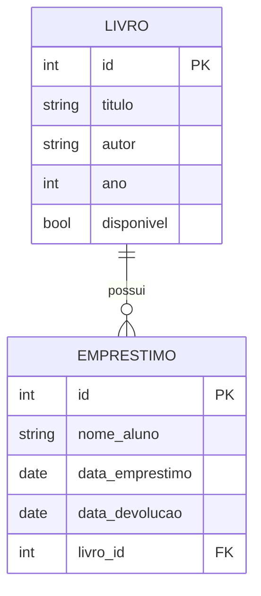

# Biblioteca Escolar

API REST para o controle do acervo e dos empréstimos de uma biblioteca escolar. O sistema permite cadastrar livros, registrar empréstimos para alunos, consultar o histórico de cada obra e registrar a devolução. Enquanto um livro está emprestado, ele fica indisponível para um novo empréstimo.

Trabalho da disciplina de Arquitetura de Software (Análise e Desenvolvimento de Sistemas). A aplicação segue arquitetura em camadas: configuração e acesso a dados em `core`, entidades em `models`, contratos de entrada e saída em `schemas` e rotas HTTP em `routers`. O banco SQLite é criado exclusivamente pelas migrações do Alembic.

## Entidades e relacionamento

Um livro possui vários empréstimos (1:N). Cada empréstimo pertence a um único livro.



- `Livro.emprestimos` lista os empréstimos da obra.
- `Emprestimo.livro` aponta para o livro emprestado.
- `data_devolucao` permanece vazia enquanto o aluno não devolve o livro.
- `disponivel` começa como verdadeiro e passa a falso no momento do empréstimo.

## Como executar

Requisito: Python 3.11 ou superior.

Abra a pasta `biblioteca-escolar` no VS Code e use o terminal integrado (Terminal, Novo Terminal):

```text
python -m venv .venv
.venv\Scripts\activate
pip install -r requirements.txt
alembic upgrade head
uvicorn app.main:app --reload
```

A documentação interativa (Swagger) fica em [http://127.0.0.1:8000/docs](http://127.0.0.1:8000/docs).

O arquivo do banco, `biblioteca.db`, é gerado na raiz do projeto pela migração. Ele não deve ser versionado.

## Endpoints

| Método | Rota | Descrição | Status codes |
| --- | --- | --- | --- |
| POST | `/livros` | Cadastra um livro | 201, 422 |
| GET | `/livros` | Lista os livros. Filtro opcional `?disponivel=true\|false` | 200 |
| GET | `/livros/{id}` | Busca um livro pelo id | 200, 404, 422 |
| PUT | `/livros/{id}` | Atualiza um livro | 200, 404, 422 |
| DELETE | `/livros/{id}` | Remove um livro sem empréstimos | 204, 404, 409 |
| GET | `/livros/{id}/emprestimos` | Histórico de empréstimos do livro | 200, 404 |
| POST | `/emprestimos` | Registra um empréstimo | 201, 404, 409, 422 |
| GET | `/emprestimos` | Lista empréstimos. Filtros `?livro_id=` e `?ativos=true` | 200, 422 |
| GET | `/emprestimos/{id}` | Busca um empréstimo pelo id | 200, 404, 422 |
| PUT | `/emprestimos/{id}/devolucao` | Registra a devolução e libera o livro | 200, 404, 409 |
| DELETE | `/emprestimos/{id}` | Remove o registro. Se estiver ativo, libera o livro antes | 204, 404 |

## Regras de negócio

- Título e autor precisam ter pelo menos 2 caracteres. O ano fica entre 1000 e o ano atual.
- O nome do aluno precisa ter pelo menos 3 caracteres.
- A data do empréstimo é a data atual. O cliente envia apenas `nome_aluno` e `livro_id`.
- O livro precisa existir. Caso contrário, a API responde 404.
- Um livro indisponível não pode ser emprestado de novo. A API responde 409 com a mensagem "Livro já está emprestado."
- Ao criar o empréstimo, o livro é marcado como indisponível na mesma transação.
- A devolução grava a data de hoje e marca o livro como disponível. Devolver um empréstimo já encerrado responde 409.
- Excluir um livro que já teve empréstimos responde 409.
- Excluir um empréstimo ainda ativo devolve o livro (`disponivel = true`) antes de apagar o registro.
- Corpo inválido responde 422, validação automática do Pydantic.
- Criações respondem 201, exclusões respondem 204 e registros inexistentes respondem 404.

## Integrantes do grupo

- Luis Gabriel dos S. A de Castro - 01800120
- David Lucas Almeida Santos - 01822127
- Luís Claudio Freitas - 01793117
- David Fernando Pascôa Lima - 01819524
- Rafael Araújo viana - 01789636
- Artênio Félix Oliveira de Albuquerque - 01774420
